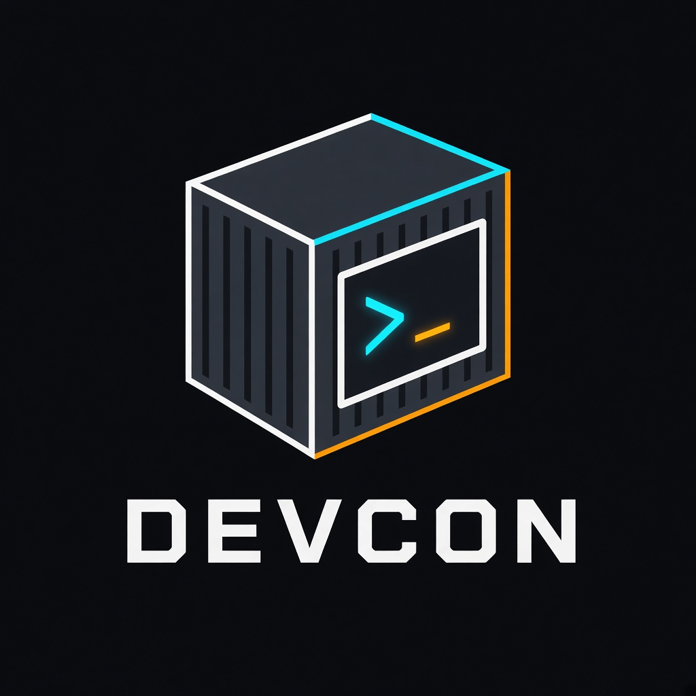
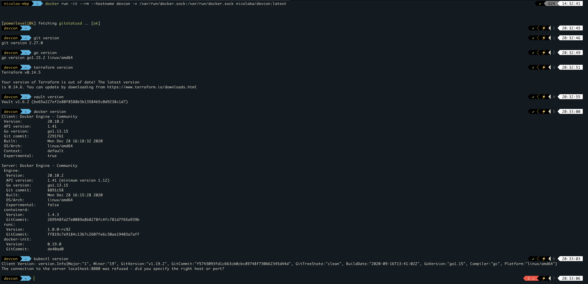

<p align="center">
  
</p>

## DEVCON: a Complete Dev Environment in a Container 📦 

**Development Container Blog Post:** [link](https://medium.com/@nicolakabar/the-ultimate-development-environment-moving-from-vagrant-to-docker-for-mac-532bcf07e186)

As a rule of thumb, I never install any packages directly onto my Mac unless I absolutely have to. So I created this sample development container that I use with Docker for Mac to be my sole dev environment.

### What's included

Pinned versions:

| Tool | Version |
| --- | --- |
| Go | 1.23.1 |
| Terraform | 1.14.6 |
| Terraform Stacks (`tfstacks`) | 0.6.1 |
| Packer | 1.14.2 |
| kubectl | 1.33.0 |
| Helm | 3.14.4 |
| aws-iam-authenticator | 0.5.9 |
| Ollama client | 0.40.14 |

Installed from the current release at build time:

- Docker CLI and the Docker Compose plugin
- kubectx and kubens
- Krew
- eksctl
- Google Cloud CLI
- AWS CLI v2 and the Session Manager plugin
- Claude Code

Shell: zsh, Oh My Zsh, Powerlevel10k, and zsh-autosuggestions.

Base packages: `apt-transport-https`, `bash-completion`, `ca-certificates`, `curl`, `dnsutils`, `file`, `fonts-powerline`, `git`, `gnupg`, `httpie`, `iproute2`, `iputils-ping`, `jq`, `less`, `locate`, `netcat-traditional`, `pipx`, `python3-pip`, `python3-setuptools`, `rsync`, `ssh`, `sudo`, `tree`, `unzip`, `vim`, `wget`, `zip`, and `zstd`.
### Usage

```
$ docker run -it --rm --hostname devcon -v /var/run/docker.sock:/var/run/docker.sock nicolaka/devcon:latest
```



Optionally, you can mount your local Mac dev directory inside the container by adding `-v /path/to/dir:/root`. Typically, I mount a specific dev directory from my Mac that contains my dot files (including  git, ssh config + keys) to make it easier to use across both Mac and within the dev container. This way I can make sure that the dev container is a throw-away, leaving no keys/secrets exposed or written in it. 

### AI Tools

The container includes two AI tools pre-installed:

- **Claude Code CLI** — Anthropic's official CLI for Claude, available as `claude` inside the container.
- **Ollama client** — The `ollama` CLI is available for interacting with local LLM models.

#### Ollama Pre-requisite (Mac)

To use Ollama from within the container, you need Ollama running natively on your Mac and configured to listen on all interfaces (not just localhost):

1. Install Ollama on your Mac: https://ollama.com/download
2. Configure Ollama to listen on `0.0.0.0` by setting the environment variable before starting it:
   ```bash
   OLLAMA_HOST=0.0.0.0 ollama serve
   ```
   Or set it persistently via `launchctl` if using the macOS app:
   ```bash
   launchctl setenv OLLAMA_HOST "0.0.0.0"
   ```
   Then restart the Ollama app.
3. Inside the container, point the Ollama client to your Mac's host:
   ```bash
   export OLLAMA_HOST=http://host.docker.internal:11434
   ollama list
   ```

Feel free to use and adjust to fit your own dev tooling!

Cheers 🍺
 

